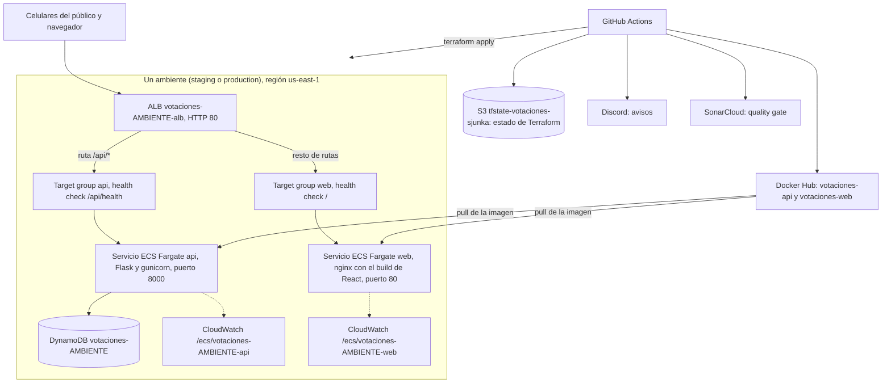

# Arquitectura

Autor: Sergio Junca. Estado al 2026-11-18: corre en AWS (cuenta personal 278835524469, us-east-1). Staging y producción están en la versión 1.0.8 (commit c5a00d4).

- Staging: http://votaciones-staging-alb-1433721465.us-east-1.elb.amazonaws.com
- Producción: http://votaciones-production-alb-267954360.us-east-1.elb.amazonaws.com
- Corren 2 ALB y 4 servicios ECS Fargate (unos US$3 al día).

## Vista general

La web llama a la API con rutas relativas (`/api/...`) por el mismo ALB. Por eso no hay CORS y la misma imagen web sirve en staging y en producción sin configuración por ambiente.

## Componentes

| Componente | Detalle | Archivo |
|---|---|---|
| Web | React con Vite. Rutas `/`, `/p/<id>` y `/acerca`. nginx con `try_files $uri /index.html`. Tarea Fargate de 256 CPU y 512 MB | `web/`, `web/Dockerfile`, `web/nginx.conf` |
| API | Flask con boto3 sobre gunicorn en el puerto 8000. Tarea Fargate de 256 CPU y 512 MB. Variables `APP_VERSION`, `APP_COMMIT`, `APP_ENV`, `TABLE_NAME`, `AWS_REGION` | `api/` |
| Base de datos | DynamoDB `votaciones-<ambiente>`, facturación bajo demanda, clave de partición `pk` | `infra/main.tf` |
| ALB | Un balanceador por ambiente, listener HTTP 80, regla `/api/*` hacia la API y acción por defecto hacia la web | `infra/main.tf` |
| ECS | Un cluster por ambiente, dos servicios con `deployment_circuit_breaker` con rollback activado | `infra/main.tf` |
| Rol de las tareas | `LabRole`, creado a mano en la cuenta (confianza `ecs-tasks`, `AmazonECSTaskExecutionRolePolicy` y `AmazonDynamoDBFullAccess`); lo lee Terraform con un data source. Es ejecución y acceso a DynamoDB a la vez | cuenta AWS |
| Logs | Un grupo de CloudWatch por servicio y ambiente | `infra/main.tf` |
| Estado de Terraform | Bucket S3 `tfstate-votaciones-sjunka`, clave `votaciones/terraform.tfstate`, workspaces `staging` y `production` | `infra/backend.hcl` |

Cada recurso lleva los tags `Project=votaciones-cicd` y `Environment`.

## Modelo de datos

Una sola tabla por ambiente. El esquema no cambia entre versiones, así un rollback de la imagen no rompe los votos guardados.

| Ítem (`pk`) | Atributos | Para qué |
|---|---|---|
| `POLL#<id>` | `question`, `options`, `votes` (enteros), `closed`, `admin_code` | La encuesta y sus conteos |
| `VOTE#<id>#<voter_id>` | marca del voto | Garantiza un voto por votante: se crea con `attribute_not_exists(pk)` |

El conteo se incrementa con un `UpdateExpression` atómico y la condición `closed = false`, así dos votos simultáneos no se pisan y una encuesta cerrada no recibe votos.

## Reglas de negocio

| Regla | Respuesta de la API |
|---|---|
| Pregunta de 3 a 200 caracteres, de 2 a 6 opciones sin repetir | 400 |
| Opción inexistente | 400 |
| Encuesta inexistente | 404 |
| Voto repetido del mismo `voter_id` o encuesta cerrada | 409 |
| Cerrar sin `X-Admin-Code` correcto | 403 |
| Porcentajes | Enteros que suman 100 (resto mayor); 0 si no hay votos |

## Ambientes

| Ambiente | Workspace de Terraform | Ambiente de GitHub | Qué lo despliega |
|---|---|---|---|
| Staging | `staging` | `staging` | Cada push a `main` |
| Producción | `production` | `production` (con revisores) | Un push a `main` ya probado en staging y aprobado a mano |
| Producción, vuelta atrás | `production` | `production-rollback` (sin revisores) | El rollback automático y el botón de pánico |

El rollback usa el mismo workspace de Terraform con otro ambiente de GitHub: así no espera a un revisor.

## Stack local

`docker-compose.yml` levanta `dynamodb` (DynamoDB Local), `api`, `web` y `gateway`, un nginx que emula el ALB y se publica en http://localhost:8080.

## Límites conocidos

- HTTP sin TLS: el ALB atiende solo el puerto 80. Chrome 157 abre los sitios por HTTPS primero, por eso Selenium usa la bandera `--disable-features=HttpsFirstBalancedModeAutoEnable` (ya pasó en el Taller 3).
- Llaves permanentes de un usuario IAM en los secretos de GitHub. Lo ideal sería OIDC.
- El rollback revierte la imagen, no la infraestructura. Un cambio de Terraform malo se corrige con `git revert` y el pipeline normal.
- Cuesta dinero real mientras los dos ambientes estén encendidos. Destruir al terminar (ver `README.md`).
