# Pipeline

Autor: Sergio Junca. Estado: diseño según el contrato del proyecto. Todavía no hay ejecuciones.

Orquestador: GitHub Actions. Contrastado con los archivos de `.github/workflows/` el 2026-11-18. Archivos en `.github/workflows/`:

| Archivo | Nombre | Para qué |
|---|---|---|
| `ci-cd.yml` | CI/CD Pipeline | CI y CD completos |
| `deploy.yml` | (workflow reutilizable) | Despliega una versión en un workspace. Lo llaman staging, producción, el rollback automático y el botón de pánico |
| `panic-rollback.yml` | Rollback de emergencia | Botón de pánico con `workflow_dispatch` |
| `pages.yml` | Sustentación en GitHub Pages | Publica `sustentacion/` |

## Flujo

```mermaid
flowchart LR
  subgraph CI["CI: build-and-test"]
    A["Checkout"] --> B["Dependencias"]
    B --> C["Black, Flake8, Pylint, ESLint"]
    C --> D["gitleaks"]
    D --> E["terraform fmt y validate"]
    E --> F["pytest y Vitest, cobertura 80 %"]
    F --> G["SonarCloud, quality gate"]
    G --> H["Versión 1.0.N, docker build x2"]
    H --> I["Trivy, falla con CRITICAL"]
    I --> J["Push a Docker Hub, solo en main"]
  end
  subgraph CD["CD, solo en main"]
    K["deploy-staging"] --> L["test-staging: integración y Selenium"]
    L --> M{"Aprobación manual: production"}
    M --> N["deploy-production"]
    N --> O["smoke-test-production"]
    O -->|"pasa"| P["publish-release v1.0.N y aviso a Discord"]
    O -->|"falla"| Q["rollback-production: última Release, smoke y aviso"]
    N -->|"falla"| Q
  end
  J --> K
  R["panic-rollback.yml, a mano"] --> S["deploy.yml, smoke y aviso"]
```

La imagen se construye una vez en `build-and-test` y se promueve sin reconstruir. Etiquetas: `1.0.N` y el SHA completo. El MAJOR.MINOR sale del archivo `VERSION`; N es `github.run_number`.

## Qué corre en cada evento

| Evento | Rama | Jobs | Resultado |
|---|---|---|---|
| `pull_request` | hacia `main` | `build-and-test` | Check verde o rojo. No publica ni despliega |
| `push` | `main` | todos | Versión `1.0.N` en staging y producción y Release `v1.0.N`, o rollback |
| `push` que solo toca `**.md`, `docs/**`, `sustentacion/**` o `pages.yml` | `main` | ninguno de `ci-cd.yml` | `paths-ignore` |
| `workflow_dispatch` en `ci-cd.yml` | cualquiera | como `push` | Corrida manual |
| `workflow_dispatch` en `panic-rollback.yml` | `main` | `rollback` | El ambiente vuelve a la versión elegida |
| `push` a `sustentacion/**` | `main` | `pages.yml` | Publica la app de la presentación |

`ci-cd.yml` usa `concurrency` sin cancelar: dos pushes seguidos no se pisan en Terraform.

## Detalles de `build-and-test`

- Black falla el job si el formato no cuadra. Flake8 y Pylint corren con `--exit-zero` y guardan su reporte, que lee SonarCloud: informan, no bloquean.
- gitleaks revisa el historial completo (`fetch-depth: 0`).
- Trivy falla solo con CVE `CRITICAL` que tengan corrección disponible (`ignore-unfixed`).
- Las imágenes se publican con `docker push --all-tags`, solo si la rama es `main`.

## Jobs de `ci-cd.yml`

| Job | Depende de | Ambiente de GitHub | Qué hace | Herramientas |
|---|---|---|---|---|
| `build-and-test` | | | Lint, secretos, IaC, pruebas con cobertura, quality gate, build y escaneo de las 2 imágenes, publicación en `main`. Salidas: `version`, `api_image`, `web_image` | Black, Flake8, Pylint, ESLint, gitleaks, Terraform, pytest, moto, Vitest, SonarCloud, Docker, Trivy |
| `deploy-staging` | `build-and-test` | `staging` | Llama a `deploy.yml` con el workspace `staging`. Salida `alb_url` | Terraform, ECS |
| `test-staging` | `deploy-staging` | | Integración de la API y E2E contra `alb_url` | pytest, requests, Selenium |
| `deploy-production` | `build-and-test`, `test-staging` | `production` | Llama a `deploy.yml` con el workspace `production`, tras la aprobación | Terraform, ECS |
| `smoke-test-production` | `deploy-production` | | Smoke de solo lectura con la versión esperada | pytest, requests |
| `publish-release` | `smoke-test-production` | | Si todo pasó: `gh release create v1.0.N --generate-notes` y aviso a Discord | GitHub CLI, webhook |
| `find-rollback-release` | `deploy-production`, `smoke-test-production` | | Corre solo si falló el deploy o el smoke de producción. `scripts/resolver-release.sh latest` devuelve la última Release (versión y commit) | GitHub CLI |
| `rollback-production` | `find-rollback-release` | `production-rollback` | Llama a `deploy.yml` con esa versión en el workspace `production` | Terraform, ECS |
| `smoke-test-rollback` | `rollback-production` | | Repite el smoke esperando la versión restaurada | pytest, requests |
| `notify-rollback` | los 3 anteriores | | Avisa a Discord si el rollback quedó verificado o falló. El run termina en rojo a propósito | webhook |
| `notify-failure` | `build-and-test`, `deploy-staging`, `test-staging` | | Avisa a Discord si algo falló antes de producción (producción no cambió) | webhook |

`build-and-test` conserva ese nombre porque el ruleset `proteger-main` lo exige como check.

## `deploy.yml`

Entradas: `tf_workspace`, `gh_environment`, `version`, `commit`. Salida: `alb_url`.

1. Configura las credenciales de AWS con `AWS_ACCESS_KEY_ID` y `AWS_SECRET_ACCESS_KEY`.
2. `terraform init -backend-config=backend.hcl` y `terraform workspace select -or-create`.
3. `terraform apply` con las variables `TF_VAR_*` (imágenes `<usuario>/votaciones-api:<version>` y `votaciones-web`).
4. Lee `alb_url` y espera hasta 5 minutos a que `/api/health` devuelva la versión pedida.

## Rollback

Automático (`rollback-production`):

1. Falla `deploy-production` o `smoke-test-production`.
2. El job busca la última Release. La versión que falló no tiene Release (se crea solo después del smoke), así que la última es la versión buena anterior.
3. Llama a `deploy.yml` con esa versión, workspace `production` y ambiente `production-rollback`.
4. Repite el smoke y avisa a Discord.

Manual (`panic-rollback.yml`): entradas `environment` (`production` o `staging`) y `version` (opcional). Con `version` vacía, el job `resolve-version` consulta el DNS del ALB con `aws elbv2`, lee la versión que responde `/api/health` y toma la Release anterior (`resolver-release.sh before`). Después corren `rollback` (`deploy.yml`; en producción usa `production-rollback`, en staging `staging`), `smoke-test` y `notify`, que avisa a Discord con el usuario que lo lanzó.

Además, el circuit breaker de ECS vuelve a la tarea anterior si la nueva no queda sana.

## Pruebas por etapa

| Prueba | Dónde | Herramienta | Qué valida |
|---|---|---|---|
| Formato y lint | CI | Black, Flake8, Pylint, ESLint | estilo y errores comunes |
| Secretos | CI | gitleaks | que no haya llaves en código ni historial |
| IaC | CI | `terraform fmt` y `validate` | infraestructura bien escrita, sin AWS |
| Unitarias, cobertura 80 % | CI | pytest con moto, Vitest | reglas de la encuesta, sin AWS |
| Calidad | CI | SonarCloud | bugs, vulnerabilidades, duplicación |
| Imagen | CI | Trivy | CVE críticos en las 2 imágenes |
| Integración | staging | pytest y requests | API real con DynamoDB real, errores 400, 404 y 409 |
| E2E | staging | Selenium | crear, votar y ver el resultado |
| Smoke | producción | pytest y requests | web carga, health `ok`, versión esperada, solo lectura |
| Smoke tras rollback | producción | las mismas | la versión restaurada responde |

## Secretos, variables y ambientes

| Nombre | Tipo | Quién lo usa |
|---|---|---|
| `AWS_ACCESS_KEY_ID`, `AWS_SECRET_ACCESS_KEY` | secretos | `deploy.yml` |
| `DOCKERHUB_TOKEN` | secreto | `build-and-test` |
| `SONAR_TOKEN` | secreto | `build-and-test` |
| `DISCORD_WEBHOOK_URL` | secreto | avisos. Si falta, el paso no falla |
| `DOCKERHUB_USERNAME` | variable | `build-and-test`, `deploy.yml` |
| `SONAR_HOST_URL` | variable | `build-and-test` |

Ambientes: `staging`, `production` (revisores Sergio y Valeria) y `production-rollback` (sin revisores).
